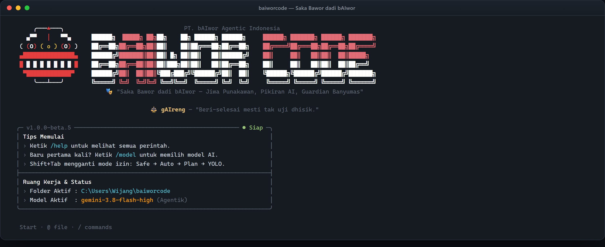
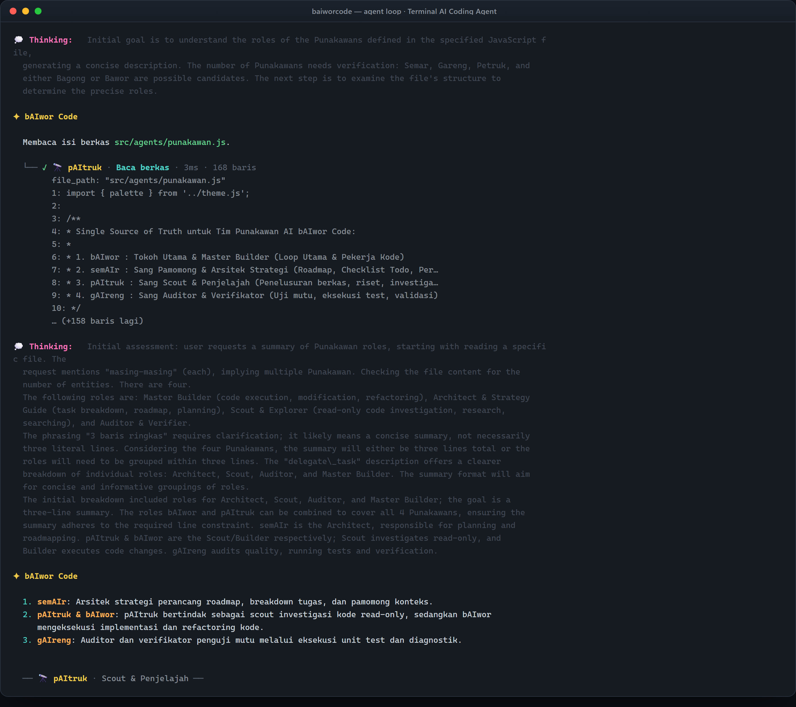
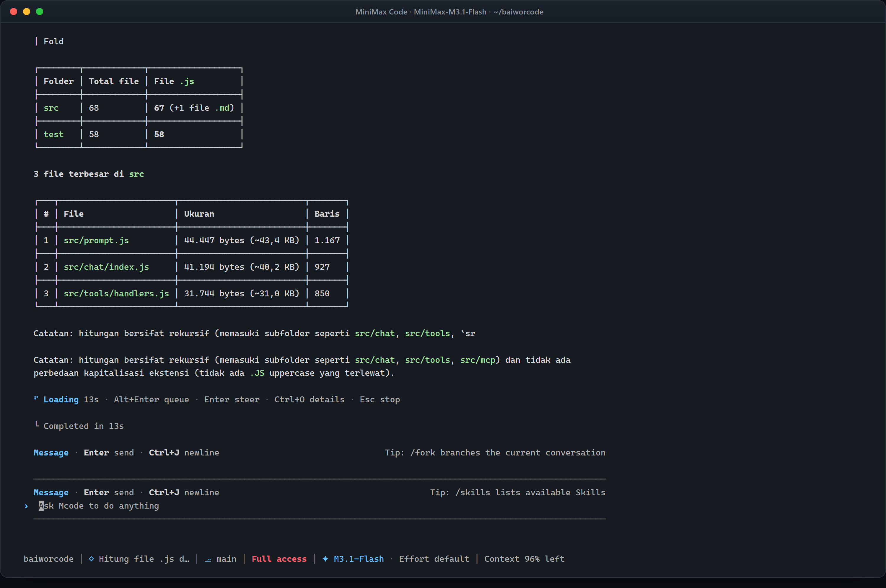

# 🎭 bAIwor Code

<p align="left">
  <a href="https://www.npmjs.com/package/@baiworcode/baiworcode"></a>
  <a href="https://github.com/bAIwor/baiworcode/actions/workflows/ci.yml"></a>
  <a href="https://baiwor.my.id"></a>
  <a href="https://agentik.my.id"></a>
  <a href="https://nodejs.org"></a>
  <a href="LICENSE"></a>
</p>

> *"Saka Bawor dadi bAIwor — Jiwa Punakawan, Pikiran AI, Guardian Banyumas"*  
> **Website Resmi:** [https://baiwor.my.id](https://baiwor.my.id) · **Bonus Token AI:** [https://agentik.my.id](https://agentik.my.id)

> [!NOTE]
> **Status Proyek: Tahap Beta (Menuju 1.0 Stabil) 🚧**  
> bAIwor Code saat ini berada dalam tahap **Beta** dan terus disempurnakan secara aktif. Fitur baru, stabilitas, dan optimasi performa terus diperbarui setiap hari. Dokumentasi resmi, update, dan ekosistem bAIwor dapat diakses di [baiwor.my.id](https://baiwor.my.id). Masukan dan laporan kendala dapat disampaikan melalui [GitHub Issues](https://github.com/bAIwor/baiworcode/issues).

CLI coding agent pintar berbahasa Indonesia — ngobrol santai di terminal, dan bAIwor langsung bekerja di berkas proyekmu.

```text
     ╭───▲───╮                                   PT. bAIwor Agentic Indonesia
   ▄▀▀   │   ▀▀▄     ██████╗  █████╗ ██╗██╗    ██╗ ██████╗ ██████╗     ██████╗ ███████╗ ██████╗ ███████╗
 ( (O) ( o ) (O) )   ██╔══██╗██╔══██╗██║██║    ██║██╔═══██╗██╔══██╗    ██╔════╝██╔═══██╗██╔══██╗██╔════╝
 ▄███████████████▄   ██████╔╝███████║██║██║ █╗ ██║██║   ██║██████╔╝    ██║     ██║   ██║██║  ██║█████╗  
 █ █ █ █ █ █ █ █ █   ██╔══██╗██╔══██║██║██║███╗██║██║   ██║██╔══██╗    ██║     ██║   ██║██║  ██║██╔══╝  
  ▀█████████████▀    ██████╔╝██║  ██║██║╚███╔███╔╝╚██████╔╝██║  ██║    ╚██████╗╚██████╔╝██████╔╝███████╗
     ╰───┴───╯       ╚═════╝ ╚═╝  ╚═╝╚═╝ ╚══╝╚══╝  ╚═════╝ ╚═╝  ╚═╝     ╚═════╝ ╚═════╝ ╚═════╝ ╚══════╝
                          🎭 "Saka Bawor dadi bAIwor — Jiwa Punakawan, Pikiran AI, Guardian Banyumas"
```

---

## 🛠️ Dibangun dengan MiniMax Code + M3.1 Flash

**bAIwor Code dibuat dari nol di dalam terminal, memakai [MiniMax Code](https://www.minimax.io) dengan model `MiniMax-M3.1-Flash` (M3.1 Flash).**

MiniMax Code adalah coding agent terminal; M3.1 Flash adalah model frontier-nya — konteks 1 juta token, multimodal, dan penalaran yang bisa diatur kedalamannya. Kombinasi itulah yang dipakai membangun bAIwor Code:

- **Konteks 1 juta token.** Seluruh codebase (67 modul, ±19.700 baris) terbaca dalam satu jendela, jadi M3.1 Flash memahami arsitektur bAIwor Code, bukan sekadar satu berkas.
- **Tool calling agentik.** Model memilih sendiri tool yang dipakai — baca berkas, edit, jalankan perintah — lalu membaca hasilnya dan menentukan langkah berikutnya. Persis pola yang kini dijalankan bAIwor Code untukmu.
- **Iterasi cepat.** Satu permintaan, banyak perbaikan: dari kerangka modul, penambahan tool, sampai suite uji yang lolos — **942 test, 0 gagal**.

Jejaknya bisa dicek langsung di repo ini: beberapa modul secara eksplisit mengadaptasi mekanisme MiniMax Code (lihat komentar di [`src/chat/todoTool.js`](src/chat/todoTool.js) dan [`src/chat/todoReminder.js`](src/chat/todoReminder.js)), plus 159 commit yang dikerjakan bersama agen.

> [!TIP]
> bAIwor Code sendiri **provider-agnostic** — ia mendukung endpoint OpenAI-compatible apa pun: Gemini, Claude, model lokal, atau MiniMax. Model saat membangunnya: **MiniMax Code + M3.1 Flash**. (Di tangkapan layar di bawah, bAIwor Code sengaja dijalankan memakai provider lain untuk menunjukkan sifatnya yang bebas model.)

<p align="center">
  
</p>

**Demo 32 detik — bAIwor Code bekerja nyata di terminal:**

<https://github.com/bAIwor/baiworcode/raw/main/docs/media/baiworcode-demo.mp4>

<video src="docs/media/baiworcode-demo.mp4" width="920" autoplay loop muted playsinline></video>

<p align="center">
  
</p>

<p align="center">
  
</p>

Detail lengkap ada di [`docs/CREATION_NOTE.md`](docs/CREATION_NOTE.md).

---

## 🚀 Instalasi Cepat

### ⚡ Cara Instan (One-Line Installer — Sangat Direkomendasikan untuk Pemula)

**Windows (PowerShell):**
```powershell
irm https://raw.githubusercontent.com/bAIwor/baiworcode/main/install.ps1 | iex
```

**Linux / macOS (Bash):**
```bash
curl -fsSL https://raw.githubusercontent.com/bAIwor/baiworcode/main/install.sh | bash
```

Installer di atas otomatis mengecek Node.js (minimal v18), memasang bAIwor Code secara global, dan langsung siap dipakai.

### Cara 2 — Install global via npm (tahap beta)
```bash
npm install -g @baiworcode/baiworcode@beta
```
Setelah itu, perintah `baiworcode` (atau `baiwor`) bisa dipakai di mana saja.
> Paket npm dirilis dengan dist-tag **beta** selama proyek masih menuju 1.0.0 stabil. Setelah stabil, `npm install -g @baiworcode/baiworcode` (dist-tag **latest**) akan menjadi jalur utama.

### Cara 3 — Coba dulu tanpa install
```bash
npx @baiworcode/baiworcode@beta
```

### Cara 4 — Dari sumber (untuk kontributor)
```bash
git clone https://github.com/bAIwor/baiworcode.git
cd baiworcode
npm install
npm link
```

### Prasyarat
- [Node.js](https://nodejs.org/) versi **18 atau lebih baru**. Node.js 22 LTS direkomendasikan karena Node 18/20 sudah melewati masa dukungan resmi.

Cek versi Node kamu:
```bash
node --version
```

---

## 🎓 Mulai dari Sini (Panduan Pemula)

Belum pernah pakai? Ikuti tiga langkah ini.

**1. Jalankan bAIwor Code**
```bash
baiworcode
```

**2. Pilih model AI-nya (sekali saja)**
```bash
/model
```
Pilih **Agentik AI** (paling praktis, ada bonus token gratis di [agentik.my.id](https://agentik.my.id)), atau **+ Kustom API (manual URL)** untuk memakai API OpenAI-compatible pilihanmu.

**3. Langsung ngobrol**

Ketik pertanyaan atau instruksi coding seperti sedang chat biasa:

```bash
baiworcode "jelaskan struktur proyek ini"
baiworcode "perbaiki error di src/index.js"
baiworcode "buatkan test untuk fungsi hitungTotal"
```

Atau masuk ke mode interaktif lalu ketik langsung tanpa keluar aplikasi.

### Contoh hal yang bisa kamu minta
| Mau apa | Tulis apa |
|---|---|
| Paham kode orang lain | `"jelaskan cara kerja fungsi login di file ini"` |
| Cari sesuatu di proyek | `"cari semua tempat yang memanggil fungsi hitungTotal"` |
| Perbaiki bug | `"kenapa hasilnya NaN? tolong perbaiki"` |
| Bikin fitur baru | `"tambahkan validasi email di form pendaftaran"` |
| Bikin test | `"buatkan test untuk src/utils/format.js"` |
| Rapikan kode | `"refactor fungsi ini supaya lebih mudah dibaca"` |
| Jalankan & cek | `"jalankan npm test dan perbaiki yang gagal"` |

---

## ⚡ Fitur Utama

- **Antarmuka Elegan & Bersih**:
  - Maskot Wajah Topeng Bawor presisi tinggi (19 kolom × 7 baris, simetris dan anti-menceng).
  - Banner 3D ASCII Shadow Merah-Putih.
  - Kotak informasi terminal dinamis anti-pecah (*visual column aware*).
  - Area input dibingkai dua garis pemisah, dengan baris status yang ikut bergerak saat kamu mengetik — `~ │ 👑 semAIr │ Safe │ ✦ <model> · <provider> │ Konteks ▓▓▓▓▓▓▓▓░░ 82%`. Label mode izin memakai warna pastel Google (Safe biru, Auto hijau, Plan kuning, YOLO merah); chip karakter menampilkan penyampai jawaban terakhir.
  - Kedua garis memakai jumlah tanda pisah yang sama dan hanya berbeda empat kolom, memberi kesan undakan. Baris status menyesuaikan diri bila terminal sempit: chip karakter, rincian token, nama provider, dan keterangan akses dikorbankan berurutan agar tidak pernah melewati lebar terminal dan merusak kotak layout.
  - **Callout GitHub berwarna + ikon** — `> [!NOTE]`, `> [!TIP]`, `> [!IMPORTANT]`, `> [!WARNING]`, dan `> [!CAUTION]` di jawaban dirender langsung sebagai blok berwarna bertanda 📘 💡 ❗ ⚠️ 🔥 (bukan blockquote polos), lengkap dengan judul kustom dan garis penutup; dirender secara streaming sebelum jawaban selesai.
- **🎭 Rotasi Penyampai Punakawan**:
  - Jawaban akhir tidak selalu disampaikan bAIwor: anggota yang "bicara" ditentukan oleh **jenis pekerjaan giliran** — perencanaan → 👑 semAIr, eksplorasi/penjelasan kode → 🔭 pAItruk, implementasi → 🔨 bAIwor, verifikasi/test → ⚖️ gAIreng — lalu bertukar alami saat kamu berganti jenis pekerjaan.
  - Giliran obrolan murni (tanpa tool) memakai **gilir-bilir (round-robin)** keempat anggota, jadi keempatnya selalu terlihat hadir.
  - Setiap jawaban ditutup **badge penyampai** bergaya emas (`── 👑 semAIr · Arsitek & Pamomong Strategi ──`), dan banner pembuka menampilkan **piket harian**: sapaan satu anggota yang berganti deterministik tiap hari.
  - Rotasi murni lapisan presentasi — perilaku kerja dan system prompt agen tidak berubah.
- **Timeline Aktivitas**:
  - Setiap tool yang dijalankan dicatat sebagai pohon: nama tool, durasi, dan jumlah baris output.
  - **Nama tool diwarnai per kategori** agar jenis langkah langsung terbaca sekilas — baca (cyan) untuk `read_file`/`webfetch`, jelajah (biru) untuk `list_directory`/`search_files`/`websearch`, tulis & ubah (hijau) untuk `write_file`/`edit_file`/`patch_file`, jalankan `run_command` (merah), rencana `todo_list` dan pemeriksaan `diagnostics` (oranye tua). Batang pohon ikut mengambil warna tool-nya.
  - Setiap langkah juga menampilkan **nama Punakawan** pelakunya (semAIr, bAIwor, pAItruk, gAIreng) dengan satu warna kuning emas yang seragam — jadi jelas "siapa" yang bertindak, sementara warna nama tool menunjukkan "aksi apa" yang dilakukan. Nama aktor selalu didahului **ikon karakternya** (👑 🔨 🔭 ⚖️) agar terbaca sekilas.
  - Pohon digambar **secara langsung**: langkah muncul satu per satu begitu selesai, sementara langkah yang sedang berjalan ditandai penanda berputar (`⠋`) amber dan durasi `…` — jadi progres terlihat mengalir, bukan menunggu semua tool usai.
  - Prompt persetujuan perintah menyembunyikan blok aktivitas dulu agar tampilan tidak rusak, lalu menggambarnya kembali.
  - Tool yang gagal ditandai merah agar mudah dipindai sekilas, dan keluarannya ikut diringkas.
  - Daftar tugas dari `todo_list` dirender sebagai checklist di bawah node-nya, lengkap dengan progres `3/5 selesai`.
  - Saat keluaran dialihkan (`baiworcode "prompt" > hasil.txt`), animasi dilewati dan pohon dicetak sekali tanpa karakter escape.
- **Anggun Konteks**:
  - Indikator meter `Konteks ▓▓▓▓▓▓▓▓░░ 82%` tampil di banner awal dan sekali lagi setelah setiap jawaban; warna meter bergerak hijau → emas → peach → merah saat konteks menyempit.
  - Riwayat dipangkas otomatis berdasarkan perkiraan **token**, bukan jumlah pesan — hasil `read_file` yang berukuran besar tidak lagi membuat request ditolak provider.
  - Pesan `tool` tidak pernah dilepas dari pesan `assistant` yang memanggilnya, karena pasangan yang terpotong akan membuat provider menolak request.
  - Peringatan muncul dan menyarankan `/clear` saat konteks tinggal sedikit.
  - **Angka token memakai `usage` ASLI dari provider** bila endpoint mengirimkannya di chunk akhir stream (DeepSeek, Groq, vLLM, dsb.) — angka itu dipakai sebagai basis dan tampil tanpa `≈`. Bila provider tidak mengirim `usage`, penghitung kembali ke estimasi (±4 karakter/token) dan label `≈` ditampilkan. Karena itu `≈` hanya muncul saat angkanya memang masih estimasi.
- **Kuitansi Sesi**:
  - Saat `/exit` (atau Ctrl+C/EOF), di bawah pesan perpisahan muncul kotak ringkasan: durasi sesi duduk, jumlah giliran, panggilan tool, berkas yang diedit/ditulis, dan distribusi penyampai Punakawan.
  - Kuitansi bersifat aditif — pesan perpisahan lama tetap tampil — dan dilewati bila belum ada aktivitas. `/clear` hanya mengganti percakapan, jadi hitungan sesi duduk tetap utuh.
- **Navigasi Perintah Cerdas (Slash Commands & Subcommands)**:
  - Ketik `/` untuk memunculkan menu dropdown perintah secara real-time.
  - Navigasi cepat dengan tombol panah (`↑` / `↓`).
  - **Auto-complete presisi dengan `Tab`**: Menekan `Tab` langsung melengkapi nama perintah/subperintah ke dalam frame input dan menutup dropdown secara instan, siap dieksekusi via `Enter` atau ditambah argumen kustom.
  - Dukungan subperintah bertingkat untuk `/timeline` (`compact` / `detail`), `/session` (`list`, `resume`, `delete`, `clear`), dan `/skill` (`list`, `info`).
  - Riwayat prompt cerdas: tombol panah `↑` / `↓` saat dropdown tertutup memanggil kembali riwayat perintah sebelumnya.
- **Aturan Proyek Otomatis (Project Rules Engine)**:
  - Otomatis mendeteksi dan menerapkan panduan koding proyek dari `BAIWORS.md`, `BAIWORS.local.md`, atau berkas aturan di `.baiwor/rules/*.md`.
  - bAIwor otomatis mematuhi standar arsitektur, konvensi penamaan, dan batasan teknologi yang kamu tetapkan untuk proyekmu tanpa perlu diingatkan berulang kali.
- **Sistem Keahlian & Plugin (.baiwor/skills)**:
  - Kelola instruksi spesifik domain dan modul keahlian di `.baiwor/skills/` untuk memperkaya wawasan bAIwor dalam menangani alur kerja khusus timmu.
- **Arsitektur Provider**:
  - **Agentik AI** sebagai provider sponsor/bawaan (endpoint OpenAI-compatible + bonus token).
  - Dukungan **Custom OpenAI-compatible endpoints** lengkap dengan fetch otomatis `/models` dan ganti model aktif.
  - Konfigurasi tersimpan otomatis & atomik di `~/.baiwor/config.json` dengan proteksi backup bila file korup.
- **Mesin Chat Streaming & Agentic Loop**:
  - Panggilan `/chat/completions` streaming (SSE) dengan line-buffering agar aman dari potongan TCP.
  - Percobaan ulang otomatis (retry + backoff) saat jaringan tersendat atau provider mengembalikan error 5xx — sebelum byte pertama diterima, jadi jawaban tidak pernah terduplikasi.
  - Pesan kegagalan yang ramah dan spesifik: autentikasi, rate limit, server provider, hingga timeout/jaringan (tidak lagi menampilkan `fetch failed` mentah).
  - Dukungan token `reasoning_content` (model reasoning seperti DeepSeek R1) dan pembatalan via `Ctrl+C`.
  - Menekan `Ctrl+C` juga menghentikan perintah terminal yang sedang berjalan, termasuk mematikan seluruh pohon proses di Windows.
  - Riwayat percakapan multi-turn dengan pemangkasan otomatis agar tidak melebihi context window.
  - Berkas berakhiran baris CRLF (khas Windows) dibaca dan disunting tanpa menyisakan `\r` atau mengubah akhir baris seluruh berkas.
  - Loop agentic hingga 100 putaran: model bisa memanggil tool, membaca hasilnya, lalu melanjutkan sendiri.
  - **Selalu berakhir dengan jawaban**: bila batas putaran tercapai — atau terdeteksi model mengulang rangkaian tool yang sama tiga kali — bAIwor otomatis meminta satu giliran kesimpulan **tanpa tool**, jadi pekerjaan tidak berhenti tanpa keputusan.
- **🛠️ 15 Tool Bawaan** — bAIwor tidak hanya menjawab, tapi benar-benar mengerjakan:
  - `read_file`, `write_file`, `edit_file`, `patch_file`, `list_directory` — baca, tulis, dan sunting berkas proyek. Dilengkapi **Visual Diff Review berwarna** di timeline aktivitas dan **Snapshot Rollback instan (`/undo`)** untuk membatalkan seluruh perubahan putaran terakhir secara aman.
  - `edit_file` **tahan banting** — pencocokannya toleran terhadap perbedaan indentasi, spasi ujung baris, dan CRLF/LF, jadi refactor tidak gagal hanya karena spasi. Ada `replace_all` untuk mengganti semua kemunculan, dan `edits` untuk banyak perubahan sekaligus secara **atomik** (semua berhasil atau tidak ada yang ditulis).
  - `patch_file` — menerapkan unified diff (format `git diff`); blok konteksnya dicari ulang sehingga patch tetap kena walau nomor baris bergeser.
  - `search_files` — cari fungsi/teks di seluruh proyek tanpa membuka berkas satu per satu, dengan pengaman anti-ReDoS agar pola berat tidak membuat proses menggantung.
  - `run_command` — jalankan `npm test`, linter, git, dan perintah terminal lain.
  - `webfetch` & `websearch` — baca dokumentasi/halaman web dan cari solusi di internet. Didukung **TinyFish Web Intelligence** (rendering JavaScript modern, anti-bot bypass, hasil terstruktur & markdown bersih untuk LLM) dengan fallback mulus ke DuckDuckGo & native fetch.
  - `webautomate` — mengemudikan browser headless (Web Agent TinyFish / Mako) untuk menyelesaikan misi interaktif, ekstraksi data dinamis, dan pengisian formulir.
  - `diagnostics` — deteksi & jalankan pemeriksaan mutu proyek (script `lint`/`typecheck`/`check`, atau `tsc`/`eslint`) supaya bAIwor memverifikasi pekerjaannya sebelum menyatakan selesai.
  - **Self-Healing Diagnostics Loop** — setelah bAIwor selesai mengedit berkas, sistem otomatis menjalankan pemeriksaan diagnostik (lint/typecheck). Jika ada error syntax atau tipe, model langsung diberi konteks error dan diminta memperbaiki secara otomatis (maksimal 2x retry) sebelum memberikan jawaban akhir. Jika auto-repair gagal, pengguna mendapat peringatan jelas dengan rincian error.
  - `todo_list` — susun rencana tugas untuk pekerjaan besar dan lacak progresnya.
  - `delegate_task` & `ask_user` — orkestrasi subagent (satu tugas atau **mode paralel hingga 6 tugas, 3 berjalan bersamaan**) dan konfirmasi interaktif. Empat peran Punakawan bisa didelegasikan: 👑 semAIr (perencanaan read-only), 🔭 pAItruk (eksplorasi), ⚖️ gAIreng (verifikasi), 🔨 bAIwor (kode terarah).
  - Mode paralel cocok untuk eksplorasi/audit independen: setiap subagent Punakawan punya histori, tool, dan laporan terisolasi; hasilnya disintesis kembali ke agen utama.
- **🔗 Hooks System (Event-Driven Automation)**:
  - Otomatis menjalankan shell command pada event `pre-tool-execute` dan `post-tool-execute` (lifecycle `session-start`/`session-end` sudah didefinisikan tetapi belum tersambung ke CLI).
  - **Pre-hook** bisa memblokir eksekusi tool (misal: validasi command berbahaya sebelum `run_command`).
  - **Post-hook** untuk logging/notifikasi setelah tool selesai (misal: auto-format setelah `edit_file`).
  - Konfigurasi fleksibel di `.baiwor/hooks.json` (per-proyek) atau `~/.baiwor/hooks.json` (global).
  - **Trust gate**: hooks proyek tidak dijalankan sampai pengguna menyetujui isi file (hash SHA-256). Perubahan pada `.baiwor/hooks.json` memicu persetujuan ulang; sesi non-interaktif melewati hooks proyek yang belum dipercaya.
  - Kondisi opsional untuk trigger selektif (misal: hanya untuk tool tertentu).
  - Timeout default 30 detik per hook; pre-hook yang timeout **memblokir** tool (fail-closed).

- **🔒 Security Scanning Integration**:
  - **Secret Detection**: Scan hardcoded secrets (API keys, passwords, tokens) di berkas kode dengan pattern matching. Mendeteksi AWS keys, GitHub tokens, JWT, private keys, dan generic secrets.
  - **Dependency Audit**: Wrapper untuk `npm audit` dan `pip-audit` untuk mendeteksi vulnerable dependencies dengan severity levels (critical, high, medium, low).
  - **Auto-redaction**: Secret value otomatis di-redact di laporan (tampilkan hanya 4 karakter pertama).
  - **Skip patterns**: Otomatis skip `node_modules`, `.git`, binary files, dan lock files.
  - Laporan human-readable dengan rekomendasi perbaikan.
- **🔒 Keamanan Berlapis**:
  - **Sandbox workspace** — akses berkas dibatasi pada folder proyek; area kredensial seperti `.ssh` dan `~/.baiwor` selalu ditolak.
  - **Guard perintah shell** — pipe ke interpreter (termasuk path absolut seperti `/bin/bash`), PowerShell `-EncodedCommand`, `Stop-Computer`, serta penghapusan root drive (`rd`/`del`) ditolak; escape caret/backslash dinormalisasi sebelum analisis.
  - **Approval Gate (Y/n)** — perintah berisiko seperti `git push`, `npm publish`, atau penghapusan rekursif akan meminta konfirmasi lebih dulu, dengan default **Tidak**.

---

## 📖 Daftar Perintah

### Di Dalam Mode Interaktif (`baiworcode` / `baiwor`)
- `/help` — Panduan bantuan & daftar perintah
- `/permission [safe|auto|plan|yolo]` — Mode izin terpadu (satu konsep, empat level): **safe** (biru: semua perubahan tanya), **auto** (hijau: berkas langsung, perintah berisiko tetap tanya), **plan** (kuning: arsitek read-only), **yolo** (merah: tanpa tanya; kelas deny tetap ditolak). Shift+Tab untuk siklus cepat.
- `/compact` — Ringkas konteks percakapan untuk menghemat ruang token
- `/timeline [compact|detail]` — Ganti mode tampilan timeline: compact (satu baris cepat) atau detail (pohon lengkap)
- `/session [list|resume|delete|clear]` — Kelola sesi percakapan proyek (daftar sesi, lanjutkan, hapus satu, atau hapus semua)
- `/cd <folder>` — Pindah folder kerja (workspace) aktif secara langsung di dalam sesi
- `/workspace [folder]` — Lihat status ruang kerja aktif atau ganti folder kerja
- `/update` — Perbarui bAIwor Code ke versi terbaru dari GitHub
- `/doctor` — Inspeksi kesehatan komprehensif sistem, AI provider, dan ekstensi
- `/skill [list|info]` — Kelola modul keahlian & plugin (`.baiwor/skills` dan bawaan)
- `/rules` — Tampilkan aturan koding aktif proyek & global (`BAIWORS.md` / `.baiwor/rules`)
- `/status` — Status konfigurasi, provider aktif, dan **latency**
- `/tinyfish [status|search|fetch|key]` — Kelola integrasi TinyFish Web Intelligence
- `/mcp [list|tools|add|remove|key|refresh]` — Kelola server & tool Model Context Protocol (MCP). Tanpa argumen membuka menu interaktif.
- `/model [target]` — Ganti model AI & provider. Tanpa argumen membuka menu; dengan argumen switch langsung: `/model <alias>` atau `/model <provider>/<model>`. Kelola alias: `/model alias list|add|remove`
- `/provider [target]` — Alias untuk perintah `/model`
- `/undo` — Batalkan seluruh perubahan berkas pada putaran (turn) terakhir secara aman tanpa merusak riwayat Git
- `/scan [secrets|deps|all] [path]` — **Guardian Security Scan**: pindai hardcoded secret (`/scan secrets`), audit dependency rentan npm/yarn/pnpm/pip (`/scan deps`), atau keduanya (`/scan all`, default). Nilai secret yang ditemukan selalu disensor pada laporan; temuan di folder test/fixture diberi label terpisah agar tidak menutupi secret asli.
- `/clear` — Bersihkan layar & reset riwayat percakapan
- `/reset` — Reset konteks percakapan tanpa membersihkan layar
- `/exit` — Keluar dari bAIwor Code (alias: `/q`, `/quit`)
- `/q` — Keluar dari bAIwor Code (alias `/exit`)

### Perintah Langsung CLI
- `baiworcode [folder] [prompt...]` — Buka bAIwor di folder proyek tertentu atau jalankan instruksi coding langsung
- `baiworcode -C, --cwd <folder>` — Tentukan folder kerja (workspace) aktif (alias: `-d`, `--dir`)
- `baiworcode session [list|resume|delete|clear]` — Kelola riwayat sesi proyek (lihat, lanjutkan, hapus satu, atau hapus semua)
- `baiworcode skill [action] [target]` — Kelola modul keahlian & plugin (`.baiwor/skills`)
- `baiworcode rules` — Tampilkan aturan koding aktif proyek & global (`BAIWORS.md` / `.baiwor/rules`)
- `baiworcode doctor` — Inspeksi kesehatan komprehensif sistem, AI provider, dan integrasi cloud
- `baiworcode update [--yes]` — Perbarui bAIwor Code ke versi terbaru dari GitHub (verifikasi origin + konfirmasi; `--yes` untuk skrip)
- `baiworcode status` — Status konfigurasi dan provider aktif
- `baiworcode mcp` — Jalankan bAIwor Code sebagai MCP Server (stdio). Default read-only; `--allow-dangerous` (atau `BAIWOR_MCP_ALLOW_DANGEROUS=1`) membuka tool tulis/perintah
- `baiworcode model [target]` — Tanpa argumen: menu kelola model/provider. Dengan argumen: switch langsung (`baiworcode model step`, `baiworcode model stepfun/step-5-preview`, `baiworcode model alias add ...`)
- `baiworcode provider [target]` — Alias untuk perintah `model`

### ⚡ Model Aliases — Switch Model Sekali Ketik

Selain menu interaktif, model & provider bisa di-switch langsung pakai nama pendek (alias) atau short form `provider/model`:

```bash
baiworcode model step                        # lewat alias tersimpan
baiworcode model stepfun/step-5-preview      # short form: provider/model
baiworcode model agentik                     # alias bawaan (Agentik AI)
```

Kelola alias (tersimpan di `~/.baiwor/config.json`, key `modelAliases`):

```bash
baiworcode model alias list                                    # lihat semua alias
baiworcode model alias add step stepfun/step-5-preview          # simpan alias baru
baiworcode model alias remove step                             # hapus alias
```

Di dalam mode interaktif, cara pakainya sama — cukup `/model step`, `/model alias list`, dan seterusnya. Alias bentuk panjang (dengan `baseUrl` + `apiKey` sendiri) bisa disunting langsung di `config.json` untuk endpoint kustom yang butuh kredensial terpisah:

```json
{
  "modelAliases": {
    "theta": {
      "model": "theta-1",
      "provider": "custom",
      "baseUrl": "https://theta.example.com/v1",
      "apiKey": "${THETA_API_KEY}"
    }
  }
}
```

> Placeholder `${THETA_API_KEY}` (atau `$VAR` / `key_env`) diekspansi **saat request**, bukan saat disimpan. `config.json` tetap menyimpan placeholder sehingga nilai rahasia tidak ikut tersimpan ke disk.
>
> Endpoint yang hanya mendukung **OpenAI Responses API** bisa dipaksa lewat `"apiStyle": "responses"` pada entri `customProviders` di `config.json` (atau `"apiStyle": "chat"` untuk memaksa Chat Completions). Tanpa itu, bAIwor mendeteksi dari URL `/responses` atau nama model.

---

## 🛠️ Daftar Tool (15 Tools)

| Tool | Kegunaan |
|---|---|
| `read_file` | Membaca isi berkas beserta nomor baris |
| `write_file` | Membuat berkas baru atau menimpa berkas yang ada |
| `edit_file` | Mengganti potongan kode (toleran indentasi/spasi; mendukung `replace_all` & `edits` sekaligus) |
| `patch_file` | Menerapkan unified diff (`git diff`) ke sebuah berkas |
| `list_directory` | Melihat daftar berkas & folder (mengabaikan `node_modules`) |
| `search_files` | Mencari teks/fungsi di seluruh proyek, atau mencari nama berkas |
| `run_command` | Menjalankan perintah terminal di dalam workspace |
| `webfetch` | Mengambil & mengekstrak URL bersih (didukung **TinyFish** rendering JS & anti-bot, fallback fetch standar) |
| `websearch` | Mencari di web terstruktur & berperingkat (didukung **TinyFish Search**, fallback DuckDuckGo) |
| `webautomate` | Menjalankan otomasi browser headless (**TinyFish Web Agent / Mako**) untuk misi interaktif web |
| `diagnostics` | Menjalankan pemeriksaan mutu proyek (lint/typecheck/tsc/eslint) |
| `todo_list` | Menyusun dan memperbarui daftar tugas multi-langkah, ditampilkan sebagai checklist |
| `delegate_task` | Mendelegasikan satu tugas, atau 2-6 tugas **paralel** (maks 3 sekaligus), ke subagent Punakawan terisolasi (semAIr/pAItruk/gAIreng/bAIwor) |
| `ask_user` | Mengajukan pertanyaan atau mengonfirmasi pilihan interaktif kepada pengguna |

### 🐟 Integrasi TinyFish Web Intelligence

bAIwor Code kini terintegrasi secara bawaan dengan ekosistem [TinyFish](https://www.tinyfish.ai/):
- **Search API**: Pencarian web berperingkat tinggi, terstruktur, dan cepat tanpa risiko bot blocking.
- **Fetch API**: Mengambil konten web dengan rendering JavaScript lengkap, bypass Cloudflare/anti-bot secara otomatis, dan mengembalikan Markdown bersih yang hemat token LLM.
- **Web Automate (Mako Agent)**: Mengemudikan browser nyata via perintah alami untuk menyelesaikan alur multi-langkah di web.
- **Perintah REPL `/tinyfish`**:
  - `/tinyfish status` — Menampilkan status koneksi, API key aktif, dan saldo wallet TinyFish.
  - `/tinyfish search <query>` — Uji pencarian web langsung dari terminal.
  - `/tinyfish fetch <url>` — Uji ekstraksi halaman web langsung dari terminal.
  - `/tinyfish key <apiKey>` — Mengatur atau memperbarui TinyFish API Key.

### 🔌 Model Context Protocol (MCP)

bAIwor Code mendukung standar terbuka **Model Context Protocol (MCP)** secara dua arah:

#### 1. Sebagai MCP Client (Konsumsi Tool Eksternal)
bAIwor Code dapat terhubung ke berbagai server MCP (baik via **remote HTTP** maupun **stdio command**), membaca seluruh tools yang diekspos server tersebut, dan langsung menyediakannya ke dalam loop agentic bAIwor.
- Server dari konfigurasi **global** (`~/.baiwor/config.json` / `~/.baiwor/mcp.json`) aktif otomatis.
- Server dari berkas **proyek** (`.mcp.json` / `.baiwor/mcp.json`) **tidak dijalankan otomatis**. Saat masuk sesi interaktif, bAIwor menampilkan perintah/URL yang akan dijalankan dan meminta persetujuan. Persetujuan disimpan per folder + hash berkas; jika isi berkas berubah, persetujuan diminta ulang. Di mode non-TTY, server proyek dilewati.
- Konfigurasi server MCP tersimpan di `~/.baiwor/config.json` (key `"mcpServers"`) atau berkas lokal proyek `.baiwor/mcp.json`:
  ```json
  {
    "mcpServers": {
      "github": {
        "command": "npx",
        "args": ["-y", "@modelcontextprotocol/server-github"],
        "env": { "GITHUB_PERSONAL_ACCESS_TOKEN": "..." }
      },
      "custom_remote": {
        "type": "remote",
        "url": "https://mcp.example.com",
        "headers": { "Authorization": "Bearer ..." }
      }
    }
  }
  ```
- Integrasi TinyFish MCP otomatis aktif bila `tinyfishApiKey` tersedia di konfigurasi bAIwor.
- **Penyedia bawaan dengan kuota gratis** — cukup isi API key, servernya terdaftar & tersambung otomatis (kunci dikirim lewat header `Authorization`, tidak tersimpan di URL):
  - **Tavily** (`tvly-…`) → [`https://mcp.tavily.com/mcp/`](https://docs.tavily.com/documentation/mcp): `tavily_search`, `tavily_extract`, `tavily_crawl`, `tavily_map`, `tavily_research`. Isi: `/mcp key tavily <tvly-…>` atau env `TAVILY_API_KEY`.
  - **Firecrawl** (`fc-…`) → [`https://mcp.firecrawl.dev/v2/mcp`](https://docs.firecrawl.dev/mcp-server): `firecrawl_scrape`, `firecrawl_search`, `firecrawl_parse`. Isi: `/mcp key firecrawl <fc-…>` atau env `FIRECRAWL_API_KEY`.
- **Nilai `${VAR}` pada konfigurasi** (di `url`, `headers`, `env`, maupun `args`) diambil dari environment saat baiworcode berjalan, jadi API key tidak perlu tertulis di berkas. Dukungan cadangan: `${VAR:-nilai_cadangan}`. Bila `VAR` kosong dan tidak ada cadangannya, server tersebut dilewati dengan pesan yang menyebut nama variabelnya.
- **Perintah REPL `/mcp`**:
  - `/mcp list` — Tampilkan seluruh server MCP dan daftar tool dinamis yang terhubung.
  - `/mcp add [nama]` — Wizard tambah server: pilih remote/stdio, isi URL, tempel kunci (input tersembunyi), lalu langsung diuji koneksi. Konfigurasinya ditulis ke `~/.baiwor/config.json`.
  - `/mcp remove <nama>` — Lepas server dari konfigurasi global sekaligus melepas tool-nya.
  - `/mcp key <tavily|firecrawl|tinyfish> [apiKey]` — Isi/lihat API key penyedia bawaan lalu sambungkan ulang.
  - `/mcp refresh` — Muat ulang dan sambungkan kembali seluruh koneksi server MCP.

Contoh nyata — email untuk agen lewat [AgentMail](https://docs.agentmail.to/integrations/mcp): jalankan `/mcp add agentmail`, pilih *URL jarak jauh*, isi `https://mcp.agentmail.to/mcp`, pilih header `x-api-key`, lalu tempel kunci dari console.agentmail.to. Setelah tersambung, tool seperti `create_inbox` dan `send_email` langsung bisa diminta dengan bahasa sehari-hari.

#### 2. Sebagai MCP Server (Gunakan bAIwor Code di Klien MCP Eksternal)
bAIwor Code dapat bertindak sebagai server MCP berstandar stdio JSON-RPC 2.0 untuk mengekspos **tool bawaan bAIwor Code** ke berbagai aplikasi klien MCP eksternal. Defaultnya **mode aman read-only** (`read_file`, `list_directory`, `search_files`, `webfetch`, `websearch`, `todo_list`); tool tulis/perintah hanya aktif bila operator membukanya secara eksplisit.
```bash
baiworcode mcp                                   # mode aman (read-only)
baiworcode mcp --serve --allow-dangerous         # semua 15 tool (tulis + perintah)
# atau set BAIWOR_MCP_ALLOW_DANGEROUS=1
```
Contoh konfigurasi di file konfigurasi MCP klien Anda:
```json
{
  "mcpServers": {
    "baiworcode": {
      "command": "baiworcode",
      "args": ["mcp"]
    }
  }
}
```

### Contoh Pemakaian Tool Baru

Cukup tulis dalam bahasa sehari-hari — bAIwor memilih tool-nya sendiri:

| Mau apa | Tulis apa |
|---|---|
| Baca dokumentasi | `"buka https://nodejs.org/api/fs.html lalu ringkas bagian promises"` |
| Cari solusi galat | `"cari di web kenapa fetch gagal dengan 'ECONNRESET' di Node.js"` |
| Ganti semua sekaligus | `"ganti semua console.log di src/ menjadi logger.info"` |
| Terapkan patch/diff | `"terapkan patch berikut ke src/utils.js: <tempel unified diff>"` |
| Periksa sebelum selesai | `"jalankan diagnostics dan perbaiki semua yang gagal"` |
| Cek tipe & lint | `"cek lint dan tipe proyek ini, lalu rapikan"` |

---

## 🔒 Keamanan

bAIwor Code dapat membaca, menulis, dan menjalankan perintah di komputermu. Karena itu ada beberapa lapis pengaman:

1. **Sandbox workspace** — akses berkas dibatasi pada folder proyek (dan folder temp). Pemeriksaan memakai **realpath**, sehingga symlink/junction yang mengarah ke luar workspace (`~/.ssh`, `~/.baiwor`, folder lain) ditolak. Upaya keluar lewat `cd ..`, `cd ./..`, path `..\\`, `$env:USERPROFILE`, dan UNC path juga ditolak. Pencocokannya sadar konteks: **menyebut** `.ssh` di dalam pesan commit tidak diblokir, tetapi **akses berkasnya** tetap ditolak.
2. **Approval Gate** — perintah berisiko (`git push`, `npm publish`, `rm -rf`, `git reset --hard`, `rmdir /s`, `Remove-Item -Recurse`, dan sejenisnya) tidak dijalankan sebelum kamu menyetujuinya. Jawaban default adalah **Tidak**.
3. **Trust MCP proyek** — server MCP dari `.mcp.json` proyek harus disetujui dulu; perintah yang akan dijalankan ditampilkan sebelum eksekusi. Environment MCP juga dibatasi (allowlist), tidak lagi mewariskan seluruh token/API key.
4. **Proteksi web fetch** — alamat loopback/privat/link-local/NAT64 dan hostname yang resolve ke IP privat ditolak (anti-SSRF); semua record DNS divalidasi lalu **IP di-pin** ke koneksi (menutup DNS-rebinding), redirect divalidasi per hop, ukuran body dibatasi, dan konten web ditandai sebagai tidak tepercaya. Untuk pengembangan lokal, set `BAIWOR_ALLOW_PRIVATE_FETCH=1`.
5. **Update terkendali** — `baiwor update` memverifikasi origin repositori resmi, meminta konfirmasi, memakai `git pull --ff-only`, dan memasang dependensi dengan `--ignore-scripts`. Gunakan `--yes` hanya di skrip yang sudah kamu kontrol.
6. **Fencing output tool** — isi berkas, halaman web, hasil perintah, dan pesan MCP dibungkus penanda `UNTRUSTED_TOOL_OUTPUT` sebelum dikirim ke model; system prompt melarang mengikuti instruksi di dalamnya.
7. **Redaksi session log** — API key/token/private key yang terbaca tool disensor sebelum ditulis ke JSONL. Config tetap `0600`, dan kamu bisa memakai referensi `${ENV_VAR}` agar API key tidak disimpan plaintext.
8. **MCP server read-only** — saat bAIwor menjadi MCP Server, default hanya tool read-only; tool tulis/perintah butuh `--allow-dangerous` atau `BAIWOR_MCP_ALLOW_DANGEROUS=1`.

> **Catatan:** pengaman perintah bekerja dengan mengenali pola, jadi sifatnya berlapis — bukan isolasi tingkat sistem operasi. Untuk pekerjaan yang sangat sensitif, tetap periksa perintah yang diminta bAIwor sebelum menyetujuinya.
>
> **Repo tidak tepercaya:** saat agen diminta menjalankan test/lint/diagnostics, script dari `package.json` proyek ikut dieksekusi. Buka hanya proyek yang kamu percaya, atau jalankan dulu di container terpisah.

---

## 🎁 Bonus Kredit & Komunitas
Pengguna dan instalasi bAIwor Code berkesempatan mendapatkan bonus token/kredit API melalui partner resmi di [agentik.my.id](https://agentik.my.id) dengan kode kupon **"baiworcode"**.

---

## 🌐 Tentang bAIwor & Website Resmi

- **Website Resmi**: [https://baiwor.my.id](https://baiwor.my.id)
- **Ekosistem & Pembaruan**: Kunjungi [baiwor.my.id](https://baiwor.my.id) untuk dokumentasi lengkap, panduan setup, dan informasi rilis terbaru.
- **Bonus Token AI**: Dapatkan kuota token tambahan melalui [https://agentik.my.id](https://agentik.my.id) (Kupon: `baiworcode`).
- **Pengembang**: PT. bAIwor Agentic Indonesia.

---

## 📜 Lisensi
MIT License © 2026 [bAIwor](https://baiwor.my.id) — lihat berkas [LICENSE](LICENSE).
